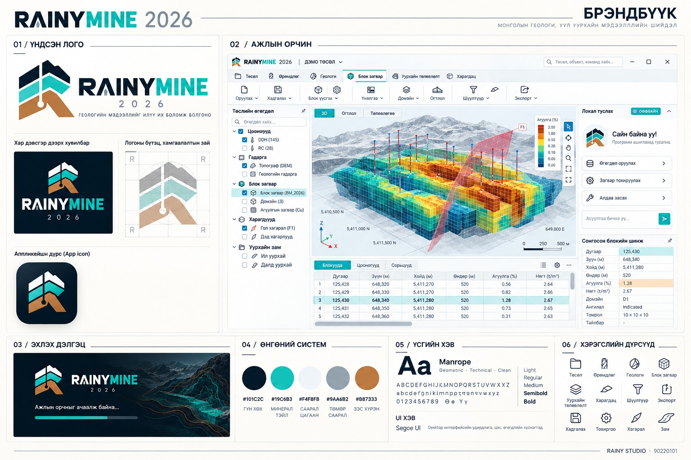
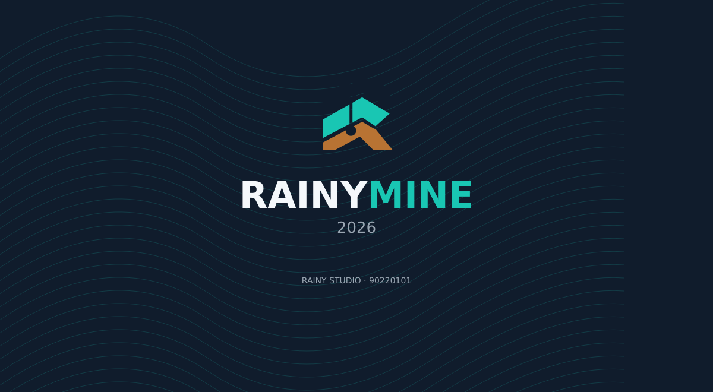

# RAINYMINE 2026 · 0.9.0

[OMF / GeoPackage / CSV–CAD metadata солилцоо](docs/OPEN_EXCHANGE.mn.md) — шинэ экспорт/импортын дэмжлэг, хувилбар, хязгаар.

[Мэргэжлийн өргөтгөл, форматын дэмжлэг ба хэмжсэн гүйцэтгэл](docs/PROFESSIONAL_WORKFLOWS.mn.md) — шинэ «Мэргэжлийн хэрэгсэл» цэс: CSG/gizmo, LAS/LAZ, GeoTIFF, SHP, Surpac ASCII, constrained RBF, IK/multipass, ramp/tunnel/ring, хязгаартай stope болон blend MILP.

**RAINY STUDIO · Лиценз ба дэмжлэг: 90220101**



[Монгол брэндбүүк](docs/BRANDBOOK.mn.md) · [Суулгах заавар](release/QUICK_START.mn.md) · [7 хоногийн лиценз](release/LICENSING.mn.md) · [Хязгаар ба шалгах хуудас](release/RELEASE_CHECKLIST.mn.md)

Сонгосон брэндбүүкийн цайвар ажлын орчин, шинэ газрын давхарга/өрөмдлөгийн тэмдэг, Монгол / English хэлний сонголттой Windows x64 хувилбар.

**[Бүх хэрэгслийн жагсаалт](docs/TOOLS.mn.md)** — зурагт харагдаагүй импорт/экспорт, QA/QC, үнэлгээ, суб-блок, хагарал, вариограмм, benchmark, зам/тээвэр, MILP, RBF, SQL, огтлолын хэрэгслүүд зургаан таб болон «Бүх хэрэгсэл», Ctrl+K дотор байна.

3D нь бодит өгөгдөл: блокийн ирмэг, тунгалаг гадаргын тор, өнгөт fault guide, дэлхийн координаттай тор, буцааж сэргээх cutaway, linked picking ба сонгосон блокийн шинж. Тасалж харах нь source блок/агуулгыг өөрчлөхгүй. Эхлэх жишээний хагарал нь зөвхөн зохиомол display guide, үнэлгээний fault constraint биш.

Хэлийг дээд мөрөөс сольж хадгална. English сонголт нь удирдлага, таб, толгой, үндсэн диалог болон шалгасан туслахын зааварт үйлчилнэ. Төслийн нэр/геологийн нэр/оруулах параметрийн утга, CSV талбаруудыг автоматаар орчуулахгүй. Зарим нарийвчилсан validation/solver-ийн текст эх хэлээрээ байна.

Доорх брэндбүүк нь баталсан загварын reference зураг. `windows-smoke.png` / `windows-smoke-en.png` нь тухайн CI build-ийн бодит интерфэйс, framebuffer-ийг харуулна.

- Зургаан ангилалтай native хэрэгслийн мөр; зүүнд давхарга/цооног/огтлол, төвд бодит 3D ба lazy блокийн хүснэгт, баруунд локал туслах.
- Лого, хэрэгслийн вектор icon, Монгол эхлэх дэлгэц. Эхлэл нь VTK импортлохоос өмнө харагдана; зохиомол ачааллын хувь, зориудын саатал байхгүй.
- **Ctrl+K**: үйлдэл хайх · **Ctrl+F1**: хэрэгслийн мөр хураах/дэлгэх · **F10**: төвлөрсөн горим · **Шошго**: бүх цооногийн нэр.
- Бодит өгөгдөл, хадгалалт, local Qwen3/llama.cpp туслах, 168 цагийн trial ба гарын үсэгтэй төхөөрөмжийн лицензийн шалгалтыг хадгалсан.

### Windows багцууд

| Багц | Хэрэглээ |
|---|---|
| `Rainymine-0.9.0-Setup-x64.exe` | Ердийн Windows суулгагч; Python шаардахгүй |
| `Rainymine-0.9.0-Windows-x64.zip` | Бүрэн задалж ажиллуулах portable |
| `Rainymine-0.9.0-AI-Offline-x64.zip` | AI загвар дотроо багтсан offline portable |
| `Rainymine-0.9.0-Release-Kit.zip` | Монгол заавар, checksum, бүртгэл, хязгаар |

Татах холбоосуудыг [GitHub Releases](https://github.com/ssboroo/Rainymine/releases)-ээс авна. Эдгээр нэр нь build-ийн гаралт; бодит бэлэн байдлыг тухайн build/release-ийн asset жагсаалтаар шалгана. Программын нэгдсэн код main-д орсон нь шинжлэх ухаан, лиценз, тоон гарын үсгийн бүх acceptance дууссан гэсэн үг биш.

### Эхлэх дэлгэц



Дэлгэрэнгүй өнгө, логоны зай, icon болон screenshot ашиглах дүрэм: **[Монгол брэндбүүк](docs/BRANDBOOK.mn.md)**.

---

## Геологи ба уурхайн тооцооны боломжууд

Эхлэх жишээ нь 720 ширхэг 50 м блоктой synthetic model; pit optimizer-ийг шууд туршиж болно. Бодит уурхай/нөөцийн эталон биш.

`Геологи / Өрөмдлөг / Уурхайн төлөвлөлт` ribbon: RBF implicit гадарга, economic pit, Excel, STL, Geobank/SQL унших.

- **RBF:** композитын агуулгын linear RBF interpolation + cutoff isosurface. 4–10000 support, 5–60 grid resolution; сонгосон bounds дотор extrapolation хийнэ. Fault, stratigraphy, signed-distance constraint болон автомат геологийн solid баталгаа байхгүй.
- **Pit:** undiscounted maximum closure-ийг HiGHS binary MILP solver-оор бодно. Блок бүрийн олборлолтын зардал, боловсруулах зардал, recovery, price болон налуугийн precedence орно. Price = нэг project grade-unit × тонн тутмын мөнгө; хувь, g/t хөрвүүлэлт автоматаар хийхгүй. 5000 хүртэл ижил хэмжээтэй, бүрэн тэгш өнцөгт parent grid; бүх grade шаардлагатай. Conservative square next-level slope stencil; model-ийн гаднах stripping орохгүй. Ramps/pushbacks, scheduling/NPV болон Whittle benchmark биш.
- **Excel:** `.xlsx`, sheet нэр, багана mapping; formula/error cell-ийг татгалзана. `.xls`, `.xlsm` дэмжихгүй.
- **STL:** ASCII/binary triangle import, double-precision ASCII export. STL-д CRS/нэгжийн metadata байхгүй; project metre гэж хэрэглэгч шалгана. Binary STL эх координат float32 нарийвчлалтай.
- **Geobank SQL:** Windows ODBC + integrated authentication; site-specific canonical views ба snapshot transaction. [Тохиргоо](GEOBANK_SQL.md). Интернэт шаардлагагүй; SQL сервер тухайн сүлжээнд хүртээмжтэй байна. Бодит байгууллагын серверийн acceptance тест хүлээгдэж байгаа.


Windows desktop, Qt/PySide6 + VTK. Интернэт, сервер, бүртгэл, API key шаардахгүй. Суулгасан EXE нь Python шаардахгүй. Эх кодын dependency таталт болон Windows build-д интернэт хэрэгтэй.

**Энэ нь хөгжүүлэлтийн / туршилтын хувилбар. Micromine-ийн бүрэн орлуулалт, баталгаажсан нөөцийн тайлан, үйлдвэрлэлийн уурхайн төлөвлөгөө гэж үзэхгүй.** Micromine-ийн код, хаалттай формат болон брэнд ашиглаагүй.

## Windows суулгагч татах

1. [Windows desktop build](https://github.com/ssboroo/Rainymine/actions/workflows/windows.yml)-ийн хамгийн сүүлийн **амжилттай** ажиллуулалтыг нээнэ.
2. **Rainymine-Windows-x64** artifact татаж задална (GitHub нэвтрэлт шаардагдаж болно).
3. `Rainymine-0.9.0-Setup-x64.exe` суулгана. Эсвэл portable ZIP-ийг бүхлээр нь задалж `Rainymine.exe` ажиллуулна.
4. GPU/драйверын улмаас цонх хар байвал `Rainymine-Software.bat` эсвэл Start цэсний CPU rendering хувилбарыг ашиглана. Mesa/llvmpipe оффлайн драйвер багцад бий. Системийн DLL/драйверийг солихгүй; CPU горим том өгөгдөлд удаан байж болно.

EXE, суулгагч бэлэн болсон эсэхийг Actions-ийн **ногоон үр дүнгээр** шалгана. Өмнөх 0.1.x/0.2.x/0.3.x/0.4.x artifact нь 0.9.0-ийн нэгдсэн боломжуудыг агуулахгүй. Кодын тоон гарын үсгийн сертификат одоогоор холбогдоогүй.

## 0.3 — Micromine төрлийн 3D ажлын урсгал

- **Харагдац** таб: давхаргын Properties, огтлол хадгалах/нээх, өмнөх/дараах огтлол (`PageUp` / `PageDown`), X/Y/Z зүсэлтийн байрлал.
- 3D дээр дарсан цооногийг хүснэгттэй холбоотой сонгож, блокийн индекс/координат/агуулга/variance-г Properties-д харуулна. Хэмжилтийн горим идэвхтэй үед сонголт өөрчлөхгүй.
- Давхарга бүрийг нуух/харуулах, opacity, RGB өнгө эсвэл агуулгын өнгө, solid/wireframe/points сонголттой. Хоёр viewport ижил тохиргоог хэрэглэнэ.
- Давхаргын тохиргоо, нэртэй огтлол, блокийн зүсэлтийн координат `.rmine` файлд хадгалагдана; undo/redo ажиллана.
- Сонголтын magenta highlight нь цагаан талбар дээр харагдана, идэвхтэй slab болон source layer visibility-г мөрдөнө.
- Шинэ блок модель тооцоход өмнөх model-ийн slice positions цэвэрлэгдэнэ. Нэртэй огтлолын шилжилт нь төслийн 3D local origin-оос хэмжигддэг хэвээр.

Энэ шинэчлэлт нь дүрслэл/ажлын урсгалд төвлөрсөн; нөөцийн тооцооны мэргэжлийн баталгаажуулалтын төлөв өөрчлөгдөөгүй.

## Мэргэжлийн интерфэйс

Цайвар ажлын орчин, нил ягаан navigation, бүлэглэсэн icon-той ribbon:

- **Төсөл:** нээх/хадгалах, CSV mapping, CRS, хүснэгт, undo/redo.
- **Өрөмдлөг:** collar/survey/assay/lithology, coverage, QA/QC controls, композит.
- **Геологи:** string/polygon засвар, constrained TIN, mesh topology, DXF/OBJ.
- **Блок загвар:** grid/domain, IDW/ordinary kriging, variogram, cross-validation, tonnage-grade.
- **Уурхай:** bench prototype, шулуун underground drive, capacity schedule.
- **Харагдац:** камер, хоёр viewport, литологийн өнгө, зай/координат, PNG/VTP.

Зүүн талд layer list ба шинж чанар/огтлол, голд том цагаан 3D талбар, доор координатын хүснэгт болон status мөр. Эхлэхэд нээгдэх **ЖИШЭЭ** төсөл нь зохиомол орд, литологи, блокийн гурван ортогонал зүсэлттэй; бодит уурхайн өгөгдөл биш.

## Боломж ба бодит хязгаар

| Чиглэл | Оруулсан боломж | Хараахан баталгаажаагүй / дутуу |
|---|---|---|
| Өгөгдөл | CSV багана mapping/preview, мөрийн алдааны тайлан, SHA256 provenance, editable grid, 20 алхмын undo/redo, v1→v2 төслийн migration | Бодит уурхайн anonymized acceptance dataset өгөөгүй; detection-limit workflow дутуу |
| CRS | PROJ/pyproj, оффлайн, explicit source/target, XY axis order, метрийн projected target, local bearing rotation | Z босоо datum ба measured-depth scale хөрвүүлэхгүй; geometry/block model үүсгэхийн өмнө хөрвүүлнэ; геодезийн хяналтын бодит цэг хэрэгтэй |
| Өрөмдлөг / QAQC | Minimum curvature, assay/lithology интервал, missing-support coverage, standard Z-score, blank threshold, duplicate RPD | Хяналтын хязгаарыг лаборатори/геологич сонгоно; зөвшөөрөлгүй outlier устгахгүй; лабораторийн бүрэн batch certification биш |
| Геометр | XYZ TIN, breakline constrained TIN ба edge verification, string/polygon vertex editor, OBJ triangles, DXF LINE/POLYLINE/3DFACE, topology/volume report | Mesh self-intersection, robust Boolean solids, fault-aware modelling, full DXF entity coverage дутуу |
| Блок / үнэлгээ | Rotated parent blocks, XY polygon domain, IDW / isotropic эсвэл geometric-anisotropic spherical ordinary kriging, midpoint block discretization, top cut, per-hole limits, rotated ellipsoid neighbor search, variogram/fit, leave-one-hole-out validation, residual/observed charts | Centre-sampled adaptive sub-block ба planar fault barrier нэмсэн; fault displacement/implicit geology, composite-support regularization, domain-by-lithology, nested variogram structures, independent real-deposit benchmark дутуу; discrete block support нь approximation |
| Тайлан | Density t/m³, cutoff scenarios, volume/tonnes/mean grade, missing volume, kriging variance атрибут | **UNCLASSIFIED**; variance нь нөөцийн ангилал биш. Density fields, geologist review, uncertainty sensitivity / reporting-code certification дутуу |
| Төлөвлөлт | Circular bench/berm/slope prototype, straight underground drive mesh, capacity/precedence reconciliation ба greedy schedule | Polyline замын gradient/fleet cycle ба optional-task economic MILP нэмсэн. Engineered ramps, curvature, geotechnics, ventilation/support, slope-sector precedence, stockpile/dispatch, global pit optimization дутуу |
| Түгээлт | Native Windows EXE, portable ZIP, Inno Setup, CPU renderer, source/packaged/installed smoke checks | Signed installer, бодит Windows төхөөрөмж/GPU matrix хараахан байхгүй |

Дэлгэрэнгүй бүтээгдэхүүний чиглэл: [ROADMAP.md](ROADMAP.md). Дээрх хязгааруудыг хэрэгжсэн мэтээр нэрлэхгүй.

## Ажиллуулах дараалал

1. `Төсөл → Шинэ`.
2. Project тохиргоогоор grade unit (%, g/t, ppm) сонгоно. Нэгж солих нь тоон утгыг хөрвүүлэхгүй.
3. `Өрөмдлөг → Амсар` сонгож CSV багануудыг зураглана. Дараа нь Survey, Сорьц, Литологи.
4. Өөр CRS-тай бол **геометр/блок модель үүсгэхийн өмнө** explicit source/target CRS-тай хөрвүүлнэ.
5. `Геологи`-д XYZ, strings/polygons, OBJ/DXF импортлоно.
6. `Блок модель үүсгэх`-д арга, search, variogram, composite coverage, bounds, cell size, domain тохируулна. Progress/cancel нь model тооцоонд ажиллана. Цуцлахад өмнөх model солигдохгүй.
7. Cross-validation, variogram, coverage/QAQC-г шалгаж дараа нь density/cutoff тайлан гаргана.
8. `.rmine` төсөлд хадгална. Хадгалах замтай өөрчлөгдсөн төсөлд 2 минут тутам `.autosave` үүснэ. Нөөцийг хуулж `.rmine` өргөтгөлтэй болгоод сэргээнэ.

## CSV форматууд

UTF-8/BOM, comma/semicolon/tab delimiter-ийг танина; эхний мөр гарчиг. Import mapping-оор өөр нэртэй баганыг зураглаж болно. Загварын нэр өгвөл амжилттай импортын дараа баганын тохиргоо төсөлд хадгалагдана. Дараагийн ижил төрлийн импортод загвараа сонгоод «Загвар хэрэглэх» дарна. Багана дутуу бол загвар хэрэглэхгүй; гараар шалгаж тохируулна. Ижил нэртэй загварыг шинэчилж болно; undo/redo дэмжинэ. Гарчиг давхардсан/хоосон эсвэл мөрийн баганын тоо зөрсөн CSV-г хүлээн авахгүй. `.xlsx`-ийг шууд нээхгүй; Excel-ээс CSV UTF-8 экспортлоно.

```csv
hole_id,x,y,z,depth,azimuth,dip
RM-001,500000,5300000,1450,250,45,-65
```

```csv
hole_id,depth,azimuth,dip
RM-001,0,45,-65
RM-001,250,60,-75
```

```csv
hole_id,from_m,to_m,grade
RM-001,0,10,0.3
```

```csv
hole_id,from_m,to_m,rock
RM-001,0,100,Боржин
```

```csv
x,y,z
499900,5299900,1450
500100,5299900,1460
500000,5300100,1455
```

QA/QC controls:

```csv
sample_id,type,measured,expected,sd
STD-1,standard,1.02,1,0.05
BLK-1,blank,0.01,,
DUP-1,duplicate,1.1,1,
```

X зүүн, Y хойд, Z дээш; ажиллах координат метр. Survey depth нь measured depth; azimuth хойноос цагийн зүүний дагуу; dip −90 босоо доош. Survey 0 м-ээс эхэлж, сүүлийн станцаас TD хүртэл тогтмол чиглэлээр сунгана. Интервалууд нэг хүснэгт дотроо давхцахгүй. Импорт бүхлээрээ хүчинтэй үед л сан солигдоно; буруу мөрийг чимээгүй алгасахгүй.

## Тооцооны тэмдэглэл

- Minimum curvature: `Δr=L/2·(u+v)·RF`, `RF=2tan(θ/2)/θ`, θ→0 үед RF=1. Partial station position нь spherical tangent interpolation-той.
- Composite нь 0-ээс anchored bins; `Σ(overlap·grade)/Σ(overlap)`, coverage нь support/bin length. Missing support 0 агуулга болж хувирахгүй.
- IDW нь сонгосон эллипсоид дотор nearest support, physical metre distance-аар жинлэнэ. Search azimuth/dip/roll нь локал X/Y/Z хайлтын радиусуудыг эргүүлнэ; default 90/0/0 нь хуучин дэлхийн XYZ тэнхлэгтэй ижил. Dip дээш эерэг; roll нь локал X-ийг тойрон Y-ийг Z рүү эргүүлнэ. Search эргэлт нь neighbor selection-д үйлчилнэ; IDW нь physical distance хэрэглэнэ. Covariance = Anisotropic үед тусдаа variogram angles ба 3 range ашиглаж `h = norm((delta @ basis) / ranges)` тооцно. Isotropic үед хуучин range metres хэрэглэнэ. Чиглэлтэй variogram fit-ийг range/angles-д хэрэглэгч өөрөө сонгож оруулна. Ordinary kriging нь spherical semivariogram + unbiasedness constraint бүхий linear system. Singular системийг unestimated гэж ил гаргана. Negative kriging grades-ийг чимээгүй clamp хийхгүй.
- Variogram нь isotropic эсвэл чиглэлтэй; azimuth нь хойноос цагийн зүүний дагуу, dip дээш эерэг, tolerance нь чиглэлийн хоёр талын хагас өнцөг, bandwidth нь тэнхлэгээс перпендикуляр хамгийн их зай (метр). Эсрэг чиглэлийн pair ижилд тооцогдоно. Lag зай нь 3D бодит зай. Чиглэлтэй fit нь exploratory бөгөөд kriging covariance-д автоматаар холбогдохгүй; олон pair дээр deterministic seed 2026 ашиглаж 250000 хүртэл pair авна. Spherical fit exploratory бөгөөд геологийн model сонголтыг орлохгүй.
- Cross-validation нь default leave-one-hole-out; withheld hole-ийн бүх support-ыг training-с хасна. Training-fold mean baseline-тай харьцуулна. Независимый geological benchmark биш.
- Grid rotation нь bounds-ийн minimum XYZ цэгийг тойрно; bounds ба cell dimensions нь эргүүлэхээс өмнөх grid coordinate. Domain нь world XY polygon ба grid-local Z bounds; cell-centre membership ашигладаг тул boundary volume нь ойролцоо. Slice нь локал grid тэнхлэгтэй эргэнэ. CSV атрибутын экспорт grid angles/origin агуулна.
- Block support = Point нь төвийн үнэлгээ. 2×2×2, 3×3×3, 4×4×4 нь блокийн дотор midpoint quadrature хэрэглэнэ. Кригингийн RHS нь sample-to-block semivariance-ийн дундаж; variance-ээс within-block semivariance-ийн дунджийг хасна. Бүх support-д centre-selected нэг neighborhood хэрэглэнэ. IDW нь ижил neighborhood-оор тооцсон subpoint утгуудын дундаж. Composite midpoint point support хэвээр; sample-support regularization, boundary-clipped partial volume, numerical convergence review дутуу.
- Top cut нь зөвхөн estimator-ийн working grade-г cap хийнэ; эх assay өөрчлөгдөхгүй. Capped count, params, status counts, source ба run SHA256 хадгална. Per-hole limit-ийн дараа minimum sample/hole нөхцөл хүрэхгүй бол unestimated. Cross-validation нь block support биш, raw observed grade-тай point holdout шалгалт.
- Tonnage нь cell volume × constant density; unestimated volume тайланд тусдаа гарна. %/g/t/ppm-ийн weighted mean grade-г тооцно, contained metal conversion эсвэл resource classification хийдэггүй.
- Эргэлттэй grid-д world-vertical precedence хараахан дэмжихгүй тул schedule үүсгэхэд алдаа гаргана. World-axis model-ийн schedule нь value-per-tonne greedy heuristic. Predecessor өмнөх period-д дууссан байна. Capacity хэтэрсэн indivisible task төлөвлөгдөхгүй; infeasibility шалтгаан гаргана. Энэ нь economic pit optimizer биш.
- VTP export нь одоогоор цооногийн локал геометр. `.origin.json` offset-г нэмэхэд absolute coordinate сэргээнэ. PNG нь үндсэн viewport.

## Хэмжээ ба шалгалт

Хүснэгт бүр 100000 мөр; 5000 collar; 50000 блок; проект/импорт 32 MB хүртэл. Том төсөл хязгаар хэтэрвэл error гарна; хуучин файл солигдохгүй. Polygon 2000 орой хүртэл. Mesh self-intersection хараахан шалгахгүй. Том model render болон зарим analysis UI-г түр ачааллуулж болно; бүх computation background thread болоогүй.

```powershell
python -m unittest discover -s tests -v
python main.py --smoke --screenshot smoke.png
```

CI нь математик/өгөгдөл/геометр тест, ribbon + 2 viewport + block scene smoke, EXE build, packaged smoke, суулгагч build, silent install, installed EXE smoke хийдэг. Windows runner нь CPU OpenGL горим ашигладаг. Энэ нь бодит хэрэглэгчийн компьютер, бүх GPU болон бодит ордын independent review-г орлохгүй.

## Эх кодоос

Python 3.11/3.12 x64. `Setup-Windows.bat` нэг удаа, дараа нь `Start-Windows.bat`.

```powershell
py -3.11 -m venv .venv
.venv\Scripts\python -m pip install -r requirements.txt
.venv\Scripts\python main.py
```

EXE: `pip install pyinstaller==6.12.0`, дараа нь `scripts/build_windows.ps1`. CPU renderer: `scripts/prepare_mesa.ps1`. Inno Setup 6: `ISCC.exe installer\Rainymine.iss`.

Dependency лицензүүд тусдаа хүчинтэй: Qt/PySide6 LGPL/GPL/Commercial, VTK BSD, NumPy/SciPy BSD, PROJ/pyproj болон ezdxf-ийн upstream licenses. Dynamic Qt libraries-ийг багцад хэвээр хадгална. Micromine native file compatibility амлаагүй.

## 0.5.0 — Sub-block / Fault / Haul / MILP / Reference workflow

- **Sub-block levels 0–3:** finest-cell centre-үүдийг world XY polygon ба fault zone-оор ангилна; ижил ангилалтай найман sibling-ийг нэгтгэнэ. Adaptive output нь geometry clipping биш; нимгэн заагийг finest resolution-оос доош барихгүй. 200000 хүртэл finest sample, 50000 output cell. Grid minimum pivot ба rotation хэвээр.
- **Fault Plane:** point + normal бүхий 8 хүртэл infinite planar barrier. Estimation, cross-validation, variogram нь fault-ийн эсрэг талын sample/pair-ийг холихгүй. Харагдах patch-ийн extent нь зөвхөн guide; barrier infinite. On-plane point нь + тал. Fault throw, displacement restoration, curved faults, implicit stratigraphy дэмжихгүй.
- **Зам / Тээвэр:** эхлээд нээлттэй XYZ String үүсгээд сонгоно. Segment-ийн 3D урт, signed gradient, max-gradient limit шалгана. Payload/trucks/speeds/loading/dumping/queue/shift/utilization-аар continuous-average cycle capacity тооцно. Curvature, turning radius, superelevation, traction, traffic, engineered ramp биш. Gradient зөрвөл fleet result үүсгэхгүй.
- **MILP Оновчлол:** world-axis parent grid, vertical column precedence ашиглана. Metal price нь **нэг тонн металлд**, бүх cost нэг currency-д байна; % → 0.01, g/t ба ppm → 1e-6 tonne-metal/tonne-rock. Recovery, mining/processing/haul costs, discount-per-period, mining/processing capacity орно. Optional tasks: ашиггүй block-ийг олборлохгүй байж болно, харин predecessor шаардлагатай бол зардалтай waste-ийг сонгоно. Solver status/gap-ийг харуулна; timeout incumbent-ийг optimal гэж нэрлэхгүй. 12000 binary, 1 сая precedence coefficients; synchronous solver нь тохируулсан 60 сек хүртэл UI-г ачааллуулж болно. Sub-block/rotated grid schedule, slope cones, haul-network coupling, stockpiles, global pit shell optimization дутуу.
- **External Benchmark:** гадаад `x,y,z,grade` CSV-тэй complete one-to-one coordinate matching ба absolute + relative tolerance-оор тоон харьцуулна. Incomplete/ambiguous/unestimated үр дүн pass болохгүй. Reference SHA256 ба model run SHA256 хадгална. `independent_review_verified` үргэлж false: өгөгдлийн гарал, эрх, real-deposit scope, reviewer sign-off тусдаа шаардлагатай. [Баталгаажуулалтын заавар](docs/EXTERNAL_VALIDATION.md).

## 0.5 — Зөвхөн Rainymine-ийн local туслах

**Харагдац → Хиймэл оюуны туслах** самбар монголоор программын ажиллагаа, тохиргоо, CSV импорт, алдаа засах зааврыг сонгож өгнө. Ерөнхий чат, геологийн шийдвэр/нөөцийн баталгаа, код үүсгэх, автоматаар үйлдэл хийхгүй.

- CPU engine: pinned llama.cpp b11796; model: Qwen3-1.7B Q4_K_M, 1,282,439,264 bytes (~1.28 GB download), pinned revision/SHA256. Model/runtime лиценз: assets/AI-NOTICES.txt, assets/QWEN_MODEL_LICENSE.txt. Суулгасан багцын root-д эдгээр лиценз мөн байна.
- **Rainymine-AI-Offline-x64 artifact доторх AI Offline portable ZIP** моделийг дотроо агуулна. Бүх ZIP-ийг задлаад Rainymine.exe нээнэ. Engine/model-д тусдаа installation, интернэт, Ollama, API key шаардахгүй.
- **Энгийн installer/portable** engine агуулна, model ороогүй. Local AI → Анх тохируулах дарж моделийг нэг удаа татна. Дараа нь оффлайн ажиллана. Model нь хэрэглэгчийн LOCALAPPDATA/Rainymine/ai/models-д хадгалагдана. Нэг удаагийн таталтад интернэт, сул диск хэрэгтэй.
- Бэлэн GGUF/llama-server файлтай бол Файл сонгох ашиглаж болно; баталгаажуулсан хослол нь дээрх Qwen3/llama.cpp. Бусад model-ийн template/JSON/CPU нийцлийг амлахгүй.
- Local модель боломжит тусламжийн ID-г сонгоно; дэлгэцийн алхмууд reviewed built-in заавраас гарна. Model-ийн дурын prose/команд/HTML хэрэглэгчид дамжуулахгүй. Эх сурвалжийн help ID харагдана. Хамааралгүй асуултыг буцааж чиглүүлнэ.
- Туслах project/assay/coordinates/logs/чатын түүхийг уншихгүй. Асуулт + сонгосон тусламжийн хэсгүүд нь зөвхөн 127.0.0.1 дээрх тухайн Rainymine-ийн эхлүүлсэн process-д очно. Proxy/redirect ашиглахгүй. API key/үүлэн inference холболт байхгүй.
- Setup болон inference background thread-д ажиллана. Зогсоох товч model process-ийг хааж RAM чөлөөлнө. Программ хаахад мөн хаана. Чат файлд хадгалахгүй; Clear нь харагдах түүх ба follow-up ID-г цэвэрлэнэ.
- Модельгүй үед зааврын dropdown нь оффлайнаар шууд ажиллана; энэ нь generative AI ажилласан гэсэн үг биш. CPU хурд/RAM-аас model startup/response хамаарна. Энэ model нь Mongolian general reasoning/геологийн мэргэжлийн чадвараар баталгаажуулагдаагүй; reviewed help routing-д л ашиглана.

Source setup: `python scripts/prepare_local_ai.py --model` (Windows runtime татна). Build нь runtime-ийг энгийн багцад, model-ийг тусдаа **Rainymine-0.9.0-AI-Offline-x64.zip** дотор оруулна. CI smoke нь бодит local model inference-ийг source, packaged болон installed EXE дотроос шалгана.

## 0.6.0 — 7 хоногийн туршилт

168 цагийн offline trial болон төхөөрөмжид холбосон, Ed25519 гарын үсэгтэй лицензийн шалгалт нэмэгдсэн. Эзэмшигчийн public key тохируулаагүй тул одоогийн build арилжааны лиценз хүлээн авахад хараахан бэлэн биш. [Монгол лицензийн заавар](release/LICENSING.mn.md), [release checklist](release/RELEASE_CHECKLIST.mn.md)-ийг үзнэ үү. Offline trial нь администраторын өөрчлөлтийн эсрэг серверийн баталгаа биш.

## SRS хэрэгжилт

[Шаардлага бүрийн хэрэгжилт, үлдэгдэл](docs/SRS_TRACEABILITY.mn.md). `Шинжилгээ / SRS` цэсэнд замналын 3 арга бүхий CSV экспорт, литологийн композит, XYZ swath, survey dogleg болон нэг үеийн feed blending LP нэмэгдсэн.

## SRS v2 инженерийн нэмэлт

[Хэрэгжилт, файл форматын v3 нийцэл, HPC/SLA-ийн үлдэгдэл](docs/SRS_V2_ENGINEERING.mn.md). `Шинжилгээ / SRS` цэсэнд Structure/Geotech импорт, 10 дүрмийн тайлан, oriented core, density композит, KE/SoR, Morton Parquet болон exposed-face горим нэмэгдсэн. Parquet-д PyArrow 19.0.1 ашиглана.
