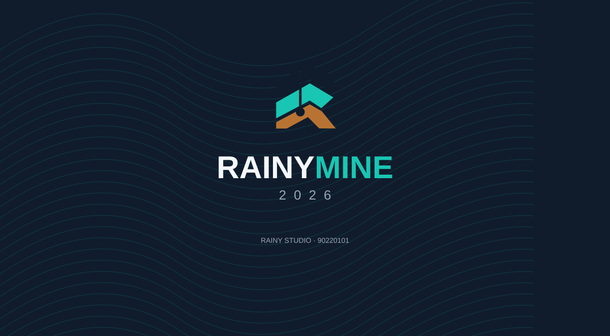

# RAINYMINE 2026 — Брэндбүүк

## Нэр ба холбоо

- Бүтээгдэхүүний нэр: **RAINYMINE**; жилийн тэмдэглэгээ: **2026**.
- Эзэмшигчийн өгсөн нийтлэх нэр: **RAINY STUDIO**.
- Лиценз ба дэмжлэгийн утас: **90220101**.
- Лого/wordmark-д “SOFTWARE” гэсэн нэмэлт үг оруулахгүй.

## Үндсэн лого

Үндсэн тэмдэг нь хөх/оюу/зэс гурван газрын давхарга, босоо өрөмдлөг ба доод дугуй цооногийн сөрөг зайтай уулын дүрс. Canonical source нь `assets/rainymine-brand.svg`; ICO, PNG, эхлэх SVG болон native icon үүнээс үүснэ. Харьцааг сунгахгүй, нэг элементээ салгаж лого гэж ашиглахгүй. Хамгаалалтын зай нь тэмдгийн өргөний 1/4-өөс багагүй. Жижиг хэрэглээнд дүрсийг дангаар, дэлгэц ба хэвлэлд RAINYMINE нэртэй хамт хэрэглэнэ.

| Хэрэглээ | Файл |
|---|---|
| Windows EXE, суулгац, shortcut | `assets/rainymine.ico` |
| PNG тэмдэг | `assets/brandmark.png` |
| Native вектор дүрс ба хэрэгслийн icon | `rainymine/icons.py` |
| Өнгө ба бүтцийн самбар | `assets/brandbook-2026.jpg` |
| Эхлэх дэлгэцийн artwork | `assets/splash.svg` |

## Өнгө

| Нэр | HEX | Үүрэг |
|---|---|---|
| Шөнийн хөх | `#101C2C` | Нэр, дүрс, үндсэн гарчиг |
| Оюу ногоон | `#19C6B3` | Брэндийн accent, сонгосон төлөв |
| Сүүн цагаан | `#F4F8FB` | Ажлын үндсэн дэвсгэр |
| Ган саарал | `#9AA6B2` | Туслах мэдээлэл, metallic хэсэг |
| Зэс хүрэн | `#B87333` | Геологийн өнгө, логоны хэсэг |
| Бараан оюу | `#008F92` | Уншигдахуйц холбоос, жижиг interactive текст |

Агуулгын шинжлэх ухааны өнгө нь брэндийн accent-аас тусдаа. Legend нь тухайн өгөгдлийн нэгж/масштабыг харуулна; геологийн утгыг маркетингийн өнгөөр солихгүй.

## Үсгийн хэв ба Монгол хэл

Windows дээр Segoe UI; тоон координат, хэмжилтийн туслах текстэд Consolas хэрэглэнэ. Монгол кирилл, Ө/Ү үсэг, бодит нэгжийг хадгална. RAINYMINE, STL, CSV, RBF зэрэг бүтээгдэхүүн/формат/аргын нэр хэвээр байна. Гуравдагч талын фонтыг зөвшөөрөлгүй багцлахгүй.

## Программын ажлын талбар

Зургаан ангилал: **Төсөл · Өрөмдлөг · Геологи · Блок загвар · Уурхайн төлөвлөлт · Харагдац**.

- Зүүн: бодит давхарга, цооног хайлт, огтлолын тохиргоо.
- Төв: бодит 3D/огтлол/төлөвлөгөө; камер, шошго, хэмжилт.
- Доод төв: төслийн блок ба цооногийн хүснэгт. Байхгүй нягт/чулуулгийн утгыг “—” гэж харуулна.
- Баруун: шалгасан программын заавар, локал AI, төслийн локал хураангуй, хэрэгсэл шууд нээх алхмууд.
- Ctrl+K: үйлдэл хайх; Ctrl+F1: хэрэгслийн мөр хураах/дэлгэх; F10: төвлөрсөн 3D горим.
- Анх зөвхөн сонгосон цооногийн нэр харагдана; **Шошго** товчоор бүх нэрийг харуулна.

## Эхлэх дэлгэц

Artwork нь heavy VTK импортын өмнө гарна. Хөдөлгөөнт зурвас нь тодорхойгүй хугацааны busy indicator; хувь зохиож харуулахгүй, зориуд хүлээлгэхгүй. Үе шатны Монгол текстийг программ өөрөө харуулна. Энэ зураг нь чимэглэлийн брэндинг бөгөөд бодит ордын 3D загвар биш. Анхны trial идэвхжүүлэх диалогийн өмнө splash нуугдана.

## Хувилбар ба түгээлт

Нэгдсэн хувилбар: **0.9.0**. Хэрэглэгчийн эхлүүлсэн 7 хоногийн /168 цаг/ туршилттай. Дуусахад төсөл устахгүй; хадгалах боломжтой идэвхжүүлэх цонх гарна.

Арилжааны public key, ашиглах гэрээ, Authenticode сертификат, бодит Windows төхөөрөмжийн acceptance болон бодит ордын хараат бус баталгаажуулалт тусдаа. Брэндбүүк нь эдгээрийг баталсан гэрчилгээ биш. [Лицензийн заавар](../release/LICENSING.mn.md), [release checklist](../release/RELEASE_CHECKLIST.mn.md), [инженерийн хязгаар](../release/KNOWN_ISSUES.mn.md)-ыг дагана.

## Бүх хэрэгслийн хэрэглээ

[Хэрэгслийн бүрэн жагсаалт](TOOLS.mn.md). Зурагт харагдаагүй бүх хэрэгсэл ижил 24px шугаман icon, Segoe UI текст, цайвар үндсэн өнгө болон оюу сонголтын төлөвтэй. Хэрэгслээ зургаан таб, Бүх хэрэгсэл болон Ctrl+K-ээс нээнэ.

Хэлийг Монгол / English сонголтоор сольж хадгална. Манропын specimen нь reference брэндийн typography; фонтыг EXE-д багцлаагүй, үндсэн UI нь Windows Segoe UI.
